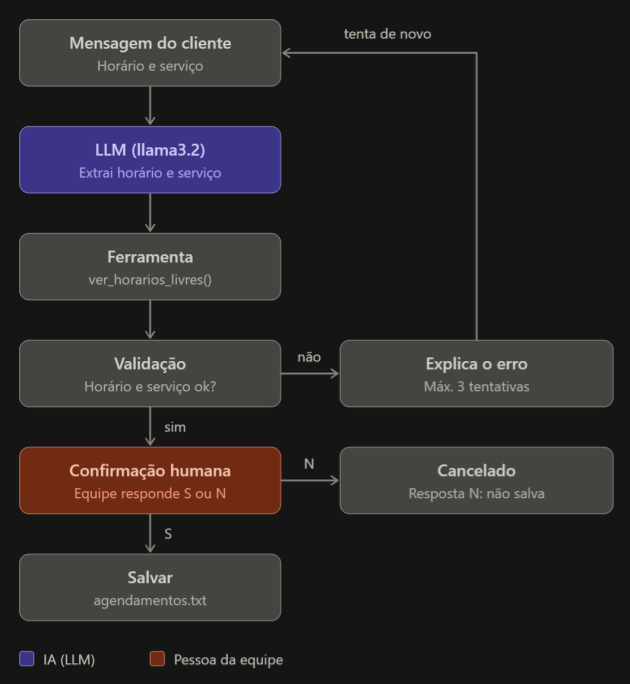

# 👨‍🔧 Agente de IA – Oficina Mecânica "Auto Fácil" 👩‍🔧

Protótipo de assistente de agendamento de revisões que roda no terminal. O cliente escreve o que precisa, um LLM local (Ollama + llama3.2) entende o pedido, o agente consulta os horários livres e **uma pessoa da equipe confirma (S/N) antes de qualquer registro ser salvo**.

## Como instalar e executar 💻

1. **Python 3.10+** e **VSCode** com a extensão *Python* instalados.
2. Instale o **Ollama** (<https://ollama.com/download>).
   
3. Abra a pasta do projeto no VSCode e, no terminal integrado, crie o ambiente virtual:
   ```bash
   python -m venv .venv
   # Windows (PowerShell):
   .venv\Scripts\Activate.ps1
   # Linux/macOS:
   source .venv/bin/activate
   ```
4. Instale a biblioteca do Ollama:
   ```bash
   pip install ollama
   ```
5. Salve o arquivo agente.py

6. Execute:
   ```bash
   python agente.py
   ```

> Para usar outro modelo, defina a variável `OLLAMA_MODEL` (ex.: `$env:OLLAMA_MODEL="qwen2.5:1.5b"`).

## Fluxo do Agente 
<p align="center">
    
</p>


## Ferramentas do Agente 🛠️

| Função | O que faz |
|---|---|
| `ver_horarios_livres()` | Devolve a lista fixa de horários livres (08h, 10h, 14h, 16h) |
| `listar_servicos()` | Devolve os serviços oferecidos |
| `agendar_horario()` | Grava o agendamento em `agendamentos.txt` (só após o "S") |
| `confirmar_com_equipe()` | Mostra o resumo e pede S/N à equipe |

## Como gerar os 3 prints de teste 🧪

1. **Confirmado:** `Quero uma troca de óleo às 14h` → equipe responde `S`.
2. **Horário indisponível:** `Quero uma revisão de freios às 11h` (ou `às 20h`) → o agente explica e mostra os horários livres.
3. **Cancelado:** `Quero alinhamento às 10h` → equipe responde `N`.

Para testar a falha final, envie 3 pedidos inválidos seguidos.

## 3 limites do agente

1. **Horários fixos e sem data:** a lista de horários livres é simulada e não controla datas nem remove horários já agendados, então dois clientes podem marcar o mesmo horário.
2. **O LLM pode errar:** o llama3.2 é um modelo pequeno e pode interpretar mal frases ambíguas ("de manhã", "depois do almoço"), erros de digitação ou dias como "dia 25". Por isso a equipe confirma antes de salvar.
3. **Feriados e recursos do computador:** o agente não conhece feriados (só bloqueia sábado e domingo) e depende do Ollama estar aberto; em computadores mais fracos a resposta pode demorar.

## Estrutura 🏗️

```
agente.py          # código do agente (comentado)
agendamentos.txt   # criado automaticamente ao confirmar com "S"
README.md
```
---
## 🎥 Demonstração e Explicação em Vídeo

O vídeo explicativo detalhando o desenvolvimento desta aplicação está disponível no link abaixo:
<p align="center">
    <a href="https://drive.google.com/file/d/14iqSqZmZlHnIJBvEKbuG8t0Zd8mU_vJ2/view?usp=drive_link" target="_blank">
    
    </a>
    <br>
    <em>Clique na imagem para assistir à apresentação deste projeto.</em>
</p>

---

# Autor

**Marcelo Yukio Takahashi**

Engenheiro Eletricista

Especialista em Projetos e Manutenção

Analista e Ciêntista de Dados

---
